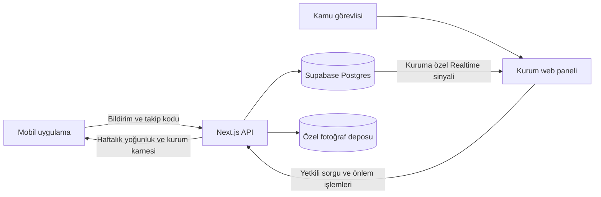

# TwoBytes | Güvenlik Haritası

Kadınlar sokakta, parkta, meydanda ve diğer kamusal alanlarda yaşadıkları tacizi veya güvenlik sorununu, kimlik bilgisi paylaşmadan haritaya işaretleyerek bildirebilir. Kamuya açık harita haftalık bildirim yoğunluğunu bölge bazında gösterir. Ayrı web panelinde yetkili kamu görevlisi kendi kurumuna yönlendirilen bildirimi inceler ve tarihli bir önleme bağlar. Bildirimi yapan kişi, önlemin durumunu ve paylaşılabilir sonucu takip koduyla görür.

Hedef, büyükşehir ve ilçe belediyelerinin ilgili birimleriyle kamu destekli bir pilot yürütmek. Kurum, bildirimleri değerlendirir, sorumlu birimi ve hedef tarihi belirler, aydınlatma veya kamera gibi uygun gördüğü saha önlemlerini kendi süreçleriyle seçer ve uygular. Uygulama, önlemin planını ve tamamlanma kaydını takip eder. İki kişilik ekibin 20 saatlik prototipi, örnek iki belediye, üç demo bölgesi ve kurgu kayıtlarla bu iş akışını gösterir.

## İlerleme

| Alan | Durum | Sahibi |
| --- | --- | --- |
| Supabase şeması, kurum yetkileri ve iki demo kurum | ✅ Yerelde doğrulandı | Barış |
| Fotoğrafsız bildirim, konuma göre yönlendirme ve ağ tekrarı | ✅ Yerelde doğrulandı | Barış |
| Kurum girişi, canlı gelen kutusu, önlemler ve gerçek takip sorgusu | ✅ Yerelde doğrulandı | Barış |
| `GET /api/map` ve `GET /api/scorecard` | 🟡 Örnek yanıt | Barış |
| Özel fotoğraf, haftalık harita özeti ve karne hesabı | ⬜ Sırada | Barış |
| Expo iskeleti, ekran taslakları ve telefondan ilk API denemesi | 🟡 iPhone'da Expo Go ile çalışıyor. Takip sorgusu, tekrar gönderim ve panel kontrolü bekliyor | Sude |
| Bildir ekranı: haritadan konum, tarih ve saat seçimi, açıklama, isteğe bağlı fotoğraf ve gönderim | 🟡 Kodlandı, iPhone'da doğrulanacak. Fotoğraflı gönderim yalnızca Storage açık API'de denenebilir | Sude |
| Harita ekranında bölge yoğunluk katmanı ve lejant | 🟡 Kodlandı, iPhone'da doğrulanacak | Sude |

### Değişiklik günlüğü

- **2026-11-28, `sude/mobile-setup`.** Harita sekmesi artık bölgeleri haritada renkli alanlar olarak gösterir ve lejantta dönem ile **Bildirim yoğunluğu** etiketi bulunur. Bölgeye dokunmak onu seçer. **Yetersiz veri** bölgeleri kesik çizgiyle gösterilir ve liste altta durur. Bildir sekmesine isteğe bağlı tek fotoğraf eklendi. Fotoğraf kütüphaneden seçilir, 2048 piksele küçültülür ve JPEG'e çevrilir. Fotoğraflı gönderim `POST /api/reports` adresine `multipart/form-data` ile gider. Alanlar `submissionId`, `latitude`, `longitude`, `occurredAt`, `description` ve `photo`. Karne sekmesine doluluk çubuğu eklendi. Yeni mobil paketler: `expo-image-picker` ve `expo-image-manipulator`. Barış için: API veya `contract.ts` değişikliği yok. Fotoğraflı gönderim `:3187` adresinde Storage olmadığı için HTTP 503 döndürür. Fotoğraf testi `:3000` adresinde yapılmalı.
- **2026-11-28, `sude/mobile-setup`.** Bildir ekranından fotoğrafsız bildirim gönderilebiliyor. Kullanıcı haritaya dokunarak yeri seçer, işaretçi son dokunulan yere taşınır ve konum izni istenmez. Olay tarihi ve saati İstanbul saatiyle seçilir. Gelecekteki veya bir yıldan eski zaman için alanın altında neden gösterilir. Gönderim `POST /api/reports` JSON gövdesini kullanır ve başarıda takip kodunu gösterir. Çift dokunma ve ağ tekrarında aynı `submissionId` korunur. Form içeriği değişirse yeni `submissionId` üretilir. Yeni mobil paketler: `react-native-maps`, `@react-native-community/datetimepicker`, `react-dom` (npm bağımlılık çakışması için `react` ile aynı sürüme sabitlendi). Barış için: API veya `contract.ts` değişikliği yok. `occurredAt` değeri `+03:00` ofsetli ISO metni olarak gönderilir.
- **2026-11-28, `sude/mobile-setup`.** iPhone'da Expo Go ile ilk fiziksel cihaz testi yapıldı. Bağlantı denemesi, Harita, Karne ve test bildirimi gönderimi çalıştı. Takip sorgusu, aynı gönderimin tekrarı ve panelde tek kayıt kontrolü beklemede. Ayrıntılar "Mobil uygulamayı çalıştırma" bölümündeki "Fiziksel telefon testi" listesinde. Barış için: yeni bir istek yok.
- **2026-11-28, `sude/mobile-setup`.** Mobil hata kutuları artık kısa teknik ayrıntı gösterir (örn. `GET /api/map · HTTP 503 · server_error`). Mobil `contract.ts` kopyası Barış'ın güncel dosyasıyla eşitlendi. Barış için: fiziksel telefonda `:3187` adresinde `GET /api/map` ve `GET /api/scorecard` HTTP 503 `server_error` döndürüyor. `:3000` adresinde ikisi de 200 dönüyor. Takip ucu `:3187` adresinde çalışıyor.
- **2026-11-28, `sude/mobile-setup`.** `apps/mobile` altında Expo (SDK 58) ve Expo Router iskeleti eklendi. Beş sekme var: Harita, Bildir, Takip, Karne ve Bağlantı. Harita, Karne ve Takip ekranları API'den okur. Bildir ekranı taslaktır ve gönderim düğmesi kapalıdır. Bağlantı sekmesi sunucuya ulaşmayı ve kurgu bir bildirim göndermeyi dener. `apps/web/src/lib/contract.ts` dosyası `apps/mobile/src/api/contract.ts` olarak birebir kopyalandı. Web tarafında değişiklik yok. Barış için: `contract.ts` değişirse mobil kopyası da güncellenmeli. Mobil, API adresini `EXPO_PUBLIC_API_URL` ile okur. Kurulum adımları aşağıdaki "Mobil uygulamayı çalıştırma" bölümünde.
- **2026-11-28, `baris/report-inbox-measures`.** Güncel `/kurum` paneli ve API yayımlanıyor. Bildirim konuma göre yönlenir ve mobil gövdeden `placeType` kaldırıldı. Takipte gönderimin döndürdüğü kod kullanılır.
- **2026-11-27, `baris/web-supabase-setup`.** Next.js API, ilk Supabase şeması ve iki demo kurum hazırlandı. Bildirim kaydı ve aynı gönderimin tekrarı doğrulandı. Harita, takip ve karne için ilk örnek yanıtlar eklendi.

## Ürün kapsamı

| Ekran | MVP davranışı |
| --- | --- |
| Anonim bildirim | Kullanıcı haritada konumu, ardından olayın tarihini ve saatini seçer. Açıklama ve bir fotoğraf isteğe bağlıdır. Kayıt tamamlandığında kopyalanabilir takip kodu görünür. |
| Kamuya açık yoğunluk haritası | Hesap gerektirmez. Sabit bölgelerde yayımlanan haftanın toplu bildirim bantları gösterilir. Lejantta dönem ve **Bildirim yoğunluğu** etiketi bulunur. |
| Kamuya açık kurum karnesi | Dönem, her kurumun tamamlanan önlem sayısı, toplam önlem sayısı ve tamamlama oranı gösterilir. |
| Takip kodu sorgusu | Kodla kurum adı, durum, varsa önlemin hedef tarihi, tamamlanma tarihi ve paylaşılabilir sonuç görülür. |
| Kurum web paneli | Görevli hesabıyla giriş yapar. Kurumuna atanan bildirimler canlı gelen kutusunda görünür. Detayda olay bilgileri ve varsa fotoğrafı inceler. Yeni önlem açabilir, bildirimi aynı kurumun mevcut önlemine bağlayabilir ve tamamlanma sonucunu kaydedebilir. |

**SDG 5.2**, kadınlara yönelik şiddet ve taciz bildirimlerinin incelenip önlemlere dönüşmesiyle ilişkilidir. **SDG 16.6**, kurumun sorumlu birimini, hedef tarihi ve tamamlanma sonucunu izlenebilir kılmasıyla ilişkilidir. Karne, kurumların açtığı önlemleri tamamlama oranını ölçer. [BM Hedef 5](https://sdgs.un.org/goals/goal5) · [BM Hedef 16](https://sdgs.un.org/goals/goal16)

## Mimari

| Katman | Teknoloji ve görev |
| --- | --- |
| Mobil | Expo, React Native ve TypeScript. Konum seçimi ve yoğunluk katmanı için `react-native-maps`, isteğe bağlı fotoğraf için `expo-image-picker`. İlk fiziksel cihaz testi Expo Go ile yapılır. |
| Web ve API | Next.js App Router ve TypeScript. Kurum paneli `/kurum` adresinde açılır. Mobil uygulama aynı Next.js uygulamasındaki JSON API’yi çağırır. |
| Veri ve erişim | Supabase Postgres, PostGIS ve Auth. Kurum üyeliği veritabanında tutulur. Satır bazlı erişim politikaları (RLS), görevlinin kurumunun kayıtlarını okumasına ve yetkili işlemleri yapmasına izin verir. |
| Canlı gelen kutusu | Supabase Realtime, ilgili kurumun paneline yeniden sorgulama sinyali gönderir. Bağlantı kurulurken veya kesildiğinde panel veriyi beş saniyede bir yeniden çeker. |
| Özel fotoğraf | Supabase Storage özel bucket. Sunucu görseli doğrular, üst verisini kaldırarak yeniden kodlar ve saklar. Yetkili görevli, kısa ömürlü imzalı bağlantıyla açar. |



```text
TwoBytes/
├── apps/
│   ├── mobile/       # Expo mobil uygulaması planı
│   └── web/          # Next.js kurum paneli ve API
└── supabase/
    ├── migrations/   # Şema, erişim politikaları ve iş kuralları
    └── seed.sql      # İki kurgu kurum ve üç pilot bölge
```

### Kurulum ve doğrulama

Yerel Supabase için Docker çalışırken depo kökünde aşağıdaki komutları kullanın. İlk komut yerel yapılandırmayı oluşturur. `supabase start` migration’ları sırasıyla uygular ve demo kurumlarıyla bölgeleri yükler.

```bash
supabase init
supabase start
supabase status
```

Bulut ortamında `supabase/migrations/` altındaki migration’ları ortamın migration geçmişine göre sırayla uygulayın. Yeni demo ortamına `supabase/seed.sql` ile örnek kurumları ve bölgeleri yükleyin. Önceden kurulmuş demo ortamında konuma göre yönlendirme migration’ı mevcut kurum kimliklerini ve bildirimlerin önceki atamalarını korur.

Bu dalın kurum paneli ve API’si üç migration’ın da uygulandığı yerel Supabase ortamında doğrulandı. Ortak Supabase’de ilk kurulum API’si çalışıyorsa, konuma dayalı yönlendirme migration’ı ile API sürümünü birlikte geçirin. Bu migration eski `place_type` alanını ve eski `submit_report` imzasını kaldırır. Mobil entegrasyonda test sunucusunun adresini `EXPO_PUBLIC_API_URL` olarak kullanmak yeterlidir.

```bash
cd apps/web
npm ci
cp .env.example .env.local
```

`.env.local` dosyasına Supabase URL’sini, yayımlanabilir anahtarı ve sunucu anahtarını ekleyin. `TRACKING_CODE_SECRET` için en az 32 karakterlik, ortamda sabit kalan bir değer kullanın. Örneğin `openssl rand -base64 48` ile üretebilirsiniz. `SUPABASE_SECRET_KEY` ve takip kodu sırrı sunucu ortamında kalır.

```bash
npm run dev -- -H 0.0.0.0
```

Web paneli yerelde `http://localhost:3000/kurum` adresinde açılır. Başka bir terminalde `apps/web` içinden `./scripts/smoke-report.sh` çalıştırarak fotoğrafsız kaydın ve ağ tekrarının yanıtını kontrol edin. Fiziksel telefonda `EXPO_PUBLIC_API_URL` değerini, telefonun ağdan erişebildiği bilgisayarın API adresiyle ayarlayın.

Demo için Supabase Auth’ta birer görevli hesabı oluşturun. Her hesabın UUID’sini kendi kurumunun anahtarıyla eşleştirin. Diğer hesap için örnekteki `routing_key` değerini `district` olarak değiştirin.

```sql
insert into public.institution_members (user_id, institution_id)
select '<auth-kullanici-uuid>'::uuid, id
from public.institutions
where routing_key = 'metropolitan'
on conflict do nothing;
```

Fotoğrafsız kayıt, konuma göre yönlendirme, kurum paneli, önlem işlemleri ve takip kodu sorgusu veritabanına bağlıdır. Harita ve karne uçları sözleşmeye uygun örnek veri döndürür ve `X-TwoBytes-Sample: 1` başlığını taşır. Expo ekranları, gerçek özet hesapları ve özel fotoğraf akışı takvimdeki sonraki teslimatlar arasındadır.

### Mobil uygulamayı çalıştırma

Telefonda Expo Go uygulaması kurulu olmalı. Telefon ve API'yi çalıştıran bilgisayar aynı ağda olmalı. Komutlar `apps/mobile` içinde çalıştırılır.

```bash
npm ci
```

`apps/mobile/.env.local` dosyasını oluşturup tek satır yazın. Adres sır değildir, ama her bilgisayarda değişir. Dosya git'e girmez.

```text
EXPO_PUBLIC_API_URL=http://<API-bilgisayarinin-ip-adresi>:<port>
```

```bash
npx expo start --clear
```

Terminaldeki QR kodunu Expo Go ile okutun. Önce **Bağlantı** sekmesinde **Bağlantıyı dene** düğmesini kullanın. Başarılı olursa **Test bildirimi gönder** takip kodu döndürür. Kod, Takip sekmesinde sorgulanabilir. Kontroller için `npm run typecheck` kullanılır.

#### Fiziksel telefon testi (iPhone, Expo Go)

- [x] **Bağlantıyı dene** HTTP 200 döndürdü (172 ms, 3 bölge).
- [x] Harita sekmesi üç bölgeyi listeler ve üçünde **Yetersiz veri** yazar. Bölgeler şimdilik liste halindedir.
- [x] Karne sekmesi Örnek Büyükşehir Belediyesi için 2/2 (%100), Örnek İlçe Belediyesi için **Bu dönemde önlem kaydı yok** gösterir.
- [x] **Test bildirimi gönder** HTTP 201 ve bir takip kodu döndürdü.
- [ ] Takip sekmesinde bu kodla durum sorgulama.
- [ ] **Aynı gönderimi tekrar dene** ile ikinci kayıt oluşmadığının kontrolü.
- [ ] Gönderilen kaydın `/kurum` panelinde tek kayıt olarak görünmesi.
- [ ] Bildir sekmesinde haritaya dokunarak konum seçimi ve işaretçinin başka bir dokunuşla taşınması.
- [ ] Gelecekteki ve bir yıldan eski zamanda alanın altında neden görünmesi, gönderimin kapalı kalması.
- [ ] Bildir sekmesinden gönderimde takip kodunun görünmesi, kodun Takip sekmesinde **İncelemede** olarak sorgulanması ve panelde tek kayıt görünmesi.
- [ ] Gönder düğmesine hızlı iki kez dokunulduğunda tek kayıt oluşması.
- [ ] Harita sekmesinde üç bölgenin renkli alan olarak çizilmesi, lejantın görünmesi ve bir bölgeye dokununca adının ve bandının yazılması.
- [ ] Bildir sekmesinde fotoğraf seçme, önizleme ve kaldırma.
- [ ] Fotoğraflı gönderim (`:3000` adresinde): takip kodunun görünmesi ve Büyükşehir görevlisinin panelde fotoğrafı açabilmesi.
- [ ] Fotoğraflı gönderim ağ hatasında **Tekrar dene** ile tek kayıt oluşması.

## Veri modeli ve iş kuralları

| Kayıt | Temel alanlar ve ilişki |
| --- | --- |
| `institutions`, `institution_members` | Kurum adı ve yönlendirme anahtarı. Üyelikte Supabase Auth kullanıcı kimliği ve kurum kimliği. |
| `map_areas` | Sabit bölge kimliği, adı, sınır geometrisi ve kurum ataması. |
| `reports` | Benzersiz gönderim kimliği, kurum, varsa bölge, özel konum, olay zamanı, gönderim zamanı, isteğe bağlı açıklama ve özel fotoğraf anahtarı. Bir bildirim en fazla bir önleme bağlıdır. |
| `tracking_codes` | Bildirim kimliği ve takip kodunun benzersiz özeti. Sunucu erişir. |
| `measures` | Kurum, başlık, sorumlu birim, hedef tarih, açılış zamanı, varsa tamamlanma zamanı ve paylaşılabilir sonuç. Bir önlem birden fazla bildirime bağlanabilir. |
| `report_inbox_events` | Kurum kimliği ve güncellenme zamanı. Realtime ile gelen kutusunu yeniden sorgulatır. |
| `public_map_snapshots` | Yayımlanan dönem, bölge ve yoğunluk bandı. |

**Konuma göre yönlendirme.** Sunucu bildirimin koordinatını pilot bölge sınırlarıyla eşleştirir. Sınır üzerindeki noktalar eşleşmeye dahildir. Bu dağılım demo amaçlıdır. Gerçek pilotta bölgelerin ve sorumlu birimlerin eşlemesini katılımcı kurumlar belirler.

| Demo konumu | Yönlendirilen örnek kurum |
| --- | --- |
| Çarşı ve çevresi | Örnek Büyükşehir Belediyesi |
| Moda, Fenerbahçe | Örnek İlçe Belediyesi |
| Pilot bölgelerin dışı | Örnek İlçe Belediyesi inceleme kuyruğu |

**Durumlar.** Önleme bağlı olmayan bildirim **İncelemede**, açık önleme bağlı bildirim **Önlem planlandı**, tamamlanmış önleme bağlı bildirim **Tamamlandı** görünür. Bildirim ve önlem aynı kuruma ait olmalıdır. Tamamlanma zamanı sunucuda bir kez yazılır. Sonraki tamamlanma istekleri kayıtlı sonucu korur.

**Yoğunluk hesabı.** İstanbul saatine göre kapanmış takvim haftasında, gönderim tarihine göre her bölgedeki benzersiz bildirimler sayılır. Demo eşiği 5 ve bantlar `5–9`, `10–19`, `20+` şeklindedir. Eşik altındaki bölge **Yetersiz veri** görünür. Yeni bildirimler bir sonraki yayımlanan özetin hesabına katılır.

**Karne hesabı.** Son 30 günde açılan benzersiz önlemlerin kaçının bugün itibarıyla tamamlandığı hesaplanır. Oran `tamamlanan / açılan` formülüyle gösterilir. Payda sıfırsa **Bu dönemde önlem kaydı yok** görünür. Panel dönem ve zamanları İstanbul saatiyle gösterir.

### API sözleşmesi

| İşlem | İstek ve yanıt |
| --- | --- |
| `POST /api/reports` | `submissionId`, `location.latitude`, `location.longitude`, saat dilimli ISO 8601 biçiminde `occurredAt` ve isteğe bağlı `description` alır. Başarılı yanıtta `trackingCode` ve `created` bulunur. İlk kayıt `201`, aynı gönderim tekrarı aynı kodla `200` döner. Özel fotoğraf aşamasında `multipart/form-data` eklenecek. |
| `GET /api/map` | Yayımlanan haftanın dönemini, bölge geometrilerini ve yoğunluk bantlarını döndürür. |
| `POST /api/track` | Gövdede `trackingCode` alır. Kurum adını, durumu, varsa önlemin başlığını, sorumlu birimini, hedef ve tamamlanma tarihlerini ve paylaşılabilir sonucunu döndürür. |
| `GET /api/scorecard` | Kurum, dönem, tamamlanan önlem sayısı, toplam ve oran döndürür. |
| `GET /api/institution/reports` | Kurum oturumuyla gelen kutusunu yeniden eskiye sıralar. Her sayfa en fazla 50 kayıt içerir. Sonraki sayfa, yanıttaki `nextCursor` değeri `cursor` olarak gönderilerek alınır. |
| `GET /api/institution/reports/:id` | Kurum oturumuyla bildirim detayını ve bağlanabilecek aynı kurum önlemlerini döndürür. |
| `POST /api/institution/reports/:id/measure` | `action` alanıyla `open`, `link` veya `complete` işlemini yapar. Kurum üyeliği işlem sırasında veritabanında yeniden denetlenir. |

Mobil yanıt tipleri `apps/web/src/lib/contract.ts`, kurum paneli tipleri `apps/web/src/lib/institution-contract.ts` içindedir.

### Erişim ve gizlilik

- **Kamu ekranları**, bölge geometrisini, haftalık yoğunluk bandını ve kurum karnesindeki toplamları gösterir.
- **Takip kodu**, yalnızca ilgili bildirimin paylaşılabilir durumunu ve sonucunu açar. Telefon, rastgele gönderim UUID’sini ağ tekrarlarında korur. Sunucu takip kodunu bu UUID ve sunucu sırrından türetir ve kodun özetini saklar. Geçersiz kod için genel hata döner. Kod ve gönderim kimliği istek gövdesinde taşınır. Günlüklerde yalnızca maskelenmiş gönderim kimliği yer alır.
- **Takip sorguları** kaynak başına dakikada 30 istekle sınırlıdır. Vercel’de platformun sağladığı istemci IP’si kullanılır. Başka ortamlarda güvenilir ters vekilin tek doğrulanmış istemci IP’siyle üzerine yazdığı başlık `TRACKING_CLIENT_IP_HEADER` olarak ayarlanabilir. Bir istemci adresi belirlenemediğinde istekler ortak kotayı kullanır.
- **Kurum kayıtları** RLS ile ilgili kurumun yetkili personeline açılır. Tam konum, olay saati, açıklama ve özel fotoğraf kurum ekranına aittir. Realtime yalnızca kuruma ait bir güncelleme sinyali taşır. İmzalı fotoğraf bağlantıları aynı kurum yetkisine tabi tutulur.
- **Pilot hazırlığında** kurum sahipliği, yönlendirme protokolü, veri saklama süresi ve yoğunluk haritasının gizlilik etkisi, katılımcı kurumlarla birlikte değerlendirilir. Demo için kurgu kayıtlar ve örnek görseller kullanılır.

## İş bölümü ve 20 saatlik takvim

| Saat | Sude | Barış |
| --- | --- | --- |
| 0–2 | Mobil ekran taslakları, Expo kurulumu ve telefondan ilk API denemesi | Next.js ve Supabase kurulumu, iki demo kurum, örnek API yanıtları ve ilk test kaydı |
| 2–10 | Yoğunluk haritası, haritadan konum ve tarih/saat seçimi, isteğe bağlı açıklama ve fotoğraf, takip ve karne ekranları | Şema ve yetkiler, bildirim kaydı, konuma göre kuruma yönlendirme, canlı gelen kutusu, önlem işlemleri ve takip sorgusu |
| 10–14 | Mobil ekranları gerçek API’ye bağlama ve fiziksel telefon testi | Özel fotoğraf akışı, haftalık harita özeti ve karne hesabı |
| 14–17 | Birlikte uçtan uca kabul testleri ve hata düzeltmeleri | Kurumlar arası yetki kontrolü ve sunum verisinin hazırlanması |
| 17–20 | Birlikte beş dakikalık sunum ve iki prova | Son düzeltmeler ve demo yedeği |

**İlk kilometre taşı**, telefondan gönderilen fotoğrafsız bir kamusal alan bildiriminin doğru kurumun web gelen kutusunda görünmesi. Ardından önleme bağlama, takip koduyla sonuç ve kurum karnesi gösterilir.

## Kabul testleri

- [x] Hesapsız API isteği konum ve olay zamanı ile fotoğrafsız kurgu bildirim kaydeder. Aynı gönderimin eşzamanlı tekrarında tek kayıt ve aynı takip kodu elde edilir.
- [x] Yerel demoda Çarşı ve çevresi Örnek Büyükşehir Belediyesine, Moda ve pilot dışı konumlar Örnek İlçe Belediyesine yönlenir.
- [x] Yeni kayıt yetkili kurumun panelinde sayfa yenilemeden görünür. Bağlantı kesildiğinde beş saniyelik sorgulama devreye girer. Diğer kurum hesabı kaydı açamaz veya değiştiremez.
- [x] Görevli başlık, sorumlu birim ve hedef tarih girerek önlem açabilir, aynı kurumun mevcut önlemini bağlayabilir ve tamamlanmayı kaydedebilir. Geçerli kod üç durumu gösterir. Geçersiz kod genel hata döndürür.
- [ ] Fiziksel telefonda, haritadan konum ve olay zamanı seçilerek fotoğraflı ve fotoğrafsız bildirimler gönderilir. Fotoğraf kaydı başarısız olduğunda arayüz güvenli tekrar deneme sunar. Fotoğrafı ilgili kurum görevlisi açabilir.
- [ ] Kamu haritası kapanan haftanın yayımlanmış bantlarını gösterir. Eşik altı bölgeler **Yetersiz veri** görünür. Kamu ve takip yanıtlarının alanları, tablodaki paylaşılabilir sözleşmeyle sınırlıdır.
- [ ] Bir önlemi tamamlamak karne payını bir artırır. Tekrar tamamlama sonucu ve sayacı korur. Birden çok bildirimin aynı önleme bağlanması payda hesabını değiştirmez.

## Beş dakikalık sunum

| Süre | Akış |
| --- | --- |
| 0:00–0:40 | Kamusal alanda yaşanan bir güvenlik sorununun anonim olarak bildirilmesini ve kurumun verdiği yanıtın izlenmesini anlatın. |
| 0:40–2:20 | Sude haftalık haritayı gösterir, Çarşı ve çevresinde kurgu bir meydan bildirimi oluşturur ve takip kodu alır. Barış Örnek Büyükşehir Belediyesi panelinde kaydı canlı görür, meydanın aydınlatılması için açılmış önleme bağlar ve tamamlanmayı kaydeder. Sude takip koduyla sonucu açar. |
| 2:20–3:20 | Karneyi **1/2 → 2/2** olarak gösterin. Kurumun tamamlanan iş kaydını SDG 5.2 ve 16.6 ile ilişkilendirin. |
| 3:20–4:45 | İlçe ve büyükşehir belediyeleriyle kamu destekli pilotu ve ilgili kurumun saha önlemini nasıl yöneteceğini açıklayın. |
| 4:45–5:00 | Geçiş süresi. |

Karne demosunda aynı kurumda biri tamamlanmış, biri açık iki önlemle başlayın. Canlı olarak yeni önlem açılacaksa bir tamamlanmış önlemle başlayın ve **1/1 → 1/2 → 2/2** akışını gösterin.

## Kaynaklar

- Safecity, kamusal alandaki cinsel taciz ve şiddet deneyimlerine ilişkin anonim bildirimleri haritalandırarak yerel sorunları görünür kılıyor. World Justice Project, bu verilerin toplulukların ve kurumların verdiği yanıtlara nasıl katkı sağladığını aktarıyor. [World Justice Project](https://worldjusticeproject.org/news/not-alone-how-app-empowering-women-prevent-gender-based-violence)
- Ankara Büyükşehir Belediyesinin Mor Haritam uygulaması kadınların kendilerini güvende hissetmedikleri yerleri harita üzerinden belediyeye bildirmesini ve destek hizmetlerine ulaşmasını sağlıyor. [ABB Mor Haritam](https://www.ankara.bel.tr/haberler/baskentli-kadinlar-icin-mor-haritam-yeniden-kullanimda-18341)
- Teknik dokümantasyon. [Expo harita](https://docs.expo.dev/versions/latest/sdk/map-view/) · [Expo fotoğraf seçimi](https://docs.expo.dev/versions/latest/sdk/imagepicker/) · [Next.js Route Handlers](https://nextjs.org/docs/app/getting-started/route-handlers) · [Supabase RLS](https://supabase.com/docs/guides/database/postgres/row-level-security) · [Supabase Storage](https://supabase.com/docs/guides/storage/buckets/fundamentals) · [Supabase Realtime](https://supabase.com/docs/guides/realtime/postgres-changes)
