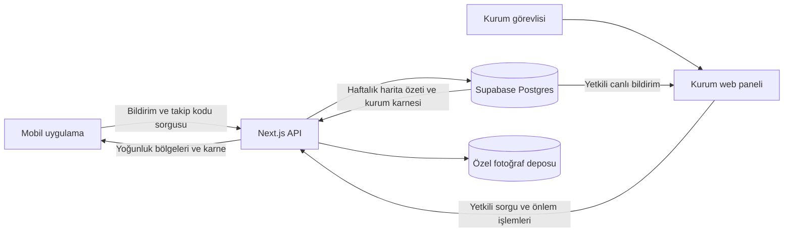

# TwoBytes | HatGüven MVP

Kadınlar, kamusal alanda yaşadıkları tacizi veya güvenlik sorununu mobil uygulamadan kimlik bilgisi paylaşmadan bildirebilir. Herkes, toplulaştırılmış bildirim yoğunluğunu ve kurumların önlem tamamlama oranını görebilir. Kurum görevlisi, kendisine yönlendirilen bildirimi web panelinde inceler ve bir önleme bağlar. Bildirimi yapan kişi, önlemin durumunu takip koduyla izler.

Bu depo, iki kişilik ekibin **20 saatte geliştireceği prototipin uygulama planını** içerir. Demo bir pilot ilçe, üç harita bölgesi, iki örnek kurum ve kurgu kayıtlarla çalışır. Sunumdaki kamu iş birliği, gerçek pilot için önerilen işletim modelidir. Aydınlatma, kamera ve benzeri önlemlerin içeriğini kurum belirler ve saha çalışmasını kurum yürütür.

## Ürün kapsamı

| Özellik | MVP davranışı |
| --- | --- |
| Anonim mobil bildirim | Kullanıcı haritadan olay konumunu, tarihini ve saatini seçer. Sahiplik kuralı için yer türünü seçer. Açıklama ve tek fotoğraf isteğe bağlıdır. Gönderim başarıyla kaydedilince kopyalanabilir takip kodu görünür. |
| Kamuya açık yoğunluk haritası | Hesapsız erişilir. Görsel referanstaki sıcak renkler, sabit bölgelerin toplu bildirim bantlarını gösterir. Lejantta veri dönemi ve **Bildirim yoğunluğu** etiketi bulunur. |
| Canlı kurum paneli | Görevli giriş yapar. Kendi kurumuna atanmış yeni bildirimler gelen kutusunda sayfa yenilemeden görünür. Detay ekranında olay bilgileri ve varsa fotoğraf açılır. |
| Tarihli önlem ve takip kodu | Görevli bir önlem açar veya bildirimi aynı kurumun mevcut önlemine bağlar. Önlemde başlık, sorumlu birim ve hedef tarih bulunur. Kapanışta tamamlanma tarihi ve paylaşılabilir sonuç kaydedilir. Kullanıcı kodla durumunu ve sonucu görür. |
| Kamuya açık kurum karnesi | Her kurum için dönem, tamamlanan önlem sayısı, toplam önlem sayısı ve tamamlama oranı gösterilir. Oran, benzersiz önlem kayıtlarından hesaplanır. |

**Mobil ekranlar** arasında yoğunluk haritası, bildirim formu, takip kodu sorgusu ve kurum karnesi bulunur. **Web paneli** giriş, gelen kutusu ve bildirim detayından oluşur. Önlem açma, bağlama ve tamamlama işlemleri bildirim detayında yapılır.

**SDG 5.2** bağlantısı, kadınlara yönelik şiddet ve taciz bildirimlerinin incelenip önlemlere dönüşmesi. **SDG 16.6** bağlantısı, kurumun sorumlu birimini, hedef tarihini ve tamamlanma sonucunu izlenebilir kılması. Prototip, uygulanan önlemleri ve kurumun iş akışını gösterir. Tamamlama oranı, açılan önlemlerin işlenişini ölçer.

## Mimari ve teknoloji seçimi

| Katman | Teknoloji ve görev |
| --- | --- |
| Mobil | Expo, React Native ve TypeScript. `react-native-maps` konum seçimi ve yoğunluk katmanı, `expo-image-picker` fotoğraf seçimi için. Fiziksel cihazda ilk doğrulama Expo Go ile. |
| Web ve API | Next.js App Router ve TypeScript. Kurum paneli ve mobil uygulamanın çağıracağı JSON API aynı Next.js uygulamasında. Fotoğraflı gönderim `multipart/form-data` kullanır. |
| Veri, oturum ve erişim | Supabase Postgres, Auth ve Row Level Security (RLS). Kurum üyeliği veritabanında tanımlanır. Kurum kullanıcıları yalnızca kendi kurumlarının kayıtlarında işlem yapabilir. |
| Dosya | Supabase Storage özel bucket. Sunucu görseli doğrular, üst verileri kaldırarak yeniden kodlar ve saklar. Yetkili görevli kısa ömürlü imzalı bağlantıyla açabilir. |
| Canlı gelen kutusu | Supabase Realtime ile yetkilendirilmiş güncelleme. Canlı bağlantı aksadığında kurum paneli beş saniyede bir veriyi tekrar çeker. |



### Önerilen depo yapısı

```text
TwoBytes/
├── README.md
├── apps/
│   ├── mobile/       # Expo mobil uygulaması
│   └── web/          # Next.js kurum paneli ve API
└── supabase/
    ├── migrations/   # Şema, erişim politikaları ve özet sorguları
    └── seed.sql      # Kurgu kurumlar, bölgeler, bildirimler ve önlemler
```

### Kurulum ve çalıştırma

**Supabase.** Bulut projesi `hatguven` (eu-central-1). Şema `supabase/migrations/`, demo kurumları ve bölgeleri `supabase/seed.sql` içindedir. İkisi de projeye uygulanmıştır.

**Web ve API** (`apps/web`, Next.js 16):

```bash
cd apps/web
npm install
cp .env.example .env.local   # Supabase URL, anahtarlar ve TRACKING_CODE_SECRET
npm run dev -- -H 0.0.0.0    # telefondan erişim için tüm arayüzlerde dinler
./scripts/smoke-report.sh    # ilk test kaydı ve tekrar deneme kontrolü
```

`SUPABASE_SECRET_KEY` yalnızca sunucu ortamında bulunur. Mobil uygulamaya konmaz.

**API durumu.** `POST /api/reports` gerçek kayıt ve kurum yönlendirmesi yapar. `GET /api/map`, `POST /api/track` ve `GET /api/scorecard` şimdilik sözleşmeye uygun örnek yanıt döndürür ve `X-HatGuven-Sample: 1` başlığını taşır. Örnek takip modunda geçerli biçimdeki bir kod `0` ile bitiyorsa tamamlanmış, bitmiyorsa planlanmış önlem döner. Ortak tipler `apps/web/src/lib/contract.ts` içindedir.

Uygulamalar ayağa kalktıkça bu bölüme diğer kurulum ve çalıştırma komutlarını ekleyin. Mobilin API adresini `EXPO_PUBLIC_API_URL` ile yapılandırın. Fiziksel telefonda yerel demo için telefonun erişebildiği bilgisayar adresini kullanın. Örnek ortam dosyasında yer tutucular, sunucu ortamında gerçek bağlantı ve servis anahtarları bulunur.

## Veri modeli ve iş kuralları

| Kayıt | Temel alanlar ve ilişki |
| --- | --- |
| `institutions` ve `institution_members` | Kurum adı ve yönlendirme anahtarı. Kurum üyeliğinde Supabase Auth kullanıcı kimliği ve kurum kimliği. |
| `map_areas` | Pilot bölge kimliği, adı ve sabit sınır geometrisi. |
| `reports` | Bildirim kimliği, benzersiz gönderim kimliği, kurum kimliği, varsa bölge kimliği, yer türü, özel konum, olay zamanı, gönderim zamanı, isteğe bağlı açıklama ve özel fotoğraf anahtarı. Bir bildirim en fazla bir önleme bağlanır. |
| `tracking_codes` | Bildirim kimliği ve takip kodunun benzersiz özeti. Sunucu tarafından erişilen ayrı kayıt. |
| `measures` | Kurum kimliği, önlem başlığı, sorumlu birim, hedef tarih, açılış zamanı, varsa tamamlanma zamanı ve kullanıcıya gösterilecek sonuç özeti. Birden fazla bildirim aynı önleme bağlanabilir. |
| `public_map_snapshots` | Yayımlanan dönem, bölge kimliği ve yoğunluk bandı. Haftalık özet, dönemdeki kurgu bildirimlerden hesaplanır. |

- **Yönlendirme.** Sunucu konumu pilot bölgelerle eşleştirir. Pilot içindeki durak bildirimi ulaşım birimine, sokak bildirimi belediye birimine gider. Eşleşmeyen bildirim belediyenin inceleme kuyruğuna düşer. Kurum ataması sunucuda yapılır.
- **Durumlar.** Önleme bağlı olmayan bildirim **İncelemede**, açık önleme bağlı bildirim **Önlem planlandı**, tamamlanmış önleme bağlı bildirim **Tamamlandı** görünür. Tamamlanma zamanı sunucuda bir kez yazılır. Bildirim ile önlem aynı kuruma ait olmalıdır.
- **Yoğunluk hesabı.** İstanbul saatine göre kapanmış takvim haftasında, gönderim tarihine göre her sabit bölgedeki benzersiz bildirimleri say. Demo eşiği **5**. Bantlar `5–9`, `10–19` ve `20+`. Eşik altındaki bölgelerin görünümü **Yetersiz veri**. Hafta özeti yayımlandığında mobil harita o özeti kullanır.
- **Karne hesabı.** Son 30 günde açılmış benzersiz önlemlerin kaçının bugün itibarıyla tamamlandığını hesapla. Formül `tamamlanan / açılan`. Payda sıfırsa **Bu dönemde önlem kaydı yok** göster. Dönem ve zamanlar ekranda İstanbul saatiyle sunulur.

### API sözleşmesi

Alan adları uygulama başlangıcında mobil ve web arasında ortaklaştırılır. Aşağıdaki sözleşme ilk entegrasyon için yeterlidir.

| İşlem | İstek ve yanıt |
| --- | --- |
| `POST /api/reports` | Konum, olay zamanı, yer türü, gönderim kimliği ve isteğe bağlı açıklama/fotoğraf alır. Başarılı kayıt yanıtı, telefonda gösterilecek takip kodunu içerir. Çift dokunma ve ağ tekrarları aynı gönderim olarak ele alınır. |
| `GET /api/map` | Son yayımlanan haftayı, bölge geometrisini ve yoğunluk bandını döndürür. |
| `POST /api/track` | Takip kodunu istek gövdesinden alır. Kurum adı, durum, varsa hedef ve tamamlanma tarihleri ile paylaşılabilir önlem özetini döndürür. |
| `GET /api/scorecard` | Kurum, dönem, tamamlanan önlem, toplam önlem ve oran alanlarını döndürür. |
| Kurum API’si | Kurum oturumuyla gelen kutusunu ve bildirim detayını okur. Önlem açma, mevcut önleme bağlama ve tamamlama işlemlerinde kurum üyeliğini yeniden denetler. |

### Erişim ve gizlilik

- **Kamu ekranları** yalnızca yayımlanmış harita özeti ve kurum karnesini okur. Harita bölgesel geometri ve bant, karne kurumsal toplamlar içerir.
- **Takip kodu ekranı** yalnızca o bildirime bağlı paylaşılabilir sonucu açar. Telefon her gönderim için kriptografik olarak rastgele bir kimlik oluşturur ve ağ tekrarlarında bu kimliği korur. Sunucu gizli bir anahtarla bu kimlikten takip kodunu türetir ve yalnızca kodun özetini saklar. Böylece tekrar deneme aynı kaydı ve kodu döndürür. Kod sorgularına hız sınırı uygula ve geçersiz kod için tek bir genel hata kullan. Kod ile gönderim kimliğini istek gövdesinde taşı ve uygulama kayıtlarında maskele.
- **Kurum ekranı** kurum yetkisini satır bazında uygular. Tam konum, olay saati, açıklama ve fotoğraf kendi kurumunun yetkili personeline açılır. Realtime kuyruğu ve imzalı fotoğraf bağlantıları aynı erişim kuralına uyar.
- **Demo ortamı** kurgu kayıtlar ve örnek görseller kullanır. Gerçek pilot tasarlanırken kurum sahipliği, yönlendirme protokolü, veri saklama süresi ve harita toplulaştırmasının gizlilik etkisi ayrıca doğrulanır.

## İş bölümü ve 20 saatlik takvim

| Saat | Sude | Barış |
| --- | --- | --- |
| 0–2 | Mobil ekran taslakları, Expo kurulumu ve telefondan ilk API denemesi | Next.js ve Supabase kurulumu, iki demo kurum, örnek API yanıtları ve ilk test kaydı |
| 2–10 | Harita, bildirim, isteğe bağlı fotoğraf, takip ve karne ekranları | Şema ve yetkiler, bildirim kaydı, kuruma yönlendirme, canlı gelen kutusu ve önlem işlemleri |
| 10–14 | Mobil ekranların gerçek API’ye bağlanması ve gerçek telefon testi | Özel fotoğraf akışı, düzenli harita özeti ve karne hesabı |
| 14–17 | Birlikte uçtan uca kabul testleri ve hata düzeltmeleri | Kurumlar arası yetki kontrolü ve demo verisinin hazırlanması |
| 17–20 | Birlikte beş dakikalık sunum ve iki prova | Son saatte son düzeltmeler ve demo yedeği |

**İlk kilometre taşı, telefondan gönderilen bir fotoğrafsız bildirimin doğru kurumun web gelen kutusunda görünmesi.** Ardından önlem atama, kodla takip ve karne tamamlanır. Harita ve isteğe bağlı fotoğraf, aynı veri modeline bağlanır.

## Kabul testleri

- [ ] Kullanıcı hesap açmadan konum ve olay zamanı seçer. Fotoğraflı ve fotoğrafsız iki kurgu bildirim kaydedilebilir ve geçerli bir takip kodu alınır.
- [ ] Aynı gönderim ağ hatası nedeniyle yeniden denenirse tek kayıt ve aynı takip kodu elde edilir. Bir fotoğraf kaydı başarısız olursa uygulama gönderimin sonucunu açıkça gösterir ve güvenli tekrar deneme sunar.
- [ ] Durak için açılan kayıt, doğru örnek kurumun panelinde manuel yenileme gerektirmeden görünür. Diğer kurum hesabı kaydı ve fotoğrafı okuyamaz veya değiştiremez.
- [ ] Kamu haritası kapanmış haftayı ve yoğunluk bandını gösterir. Eşik altındaki bölge **Yetersiz veri** görünür. Yeni kayıt kurum panelinde görünürken harita yayımlanmış haftalık özetini korur.
- [ ] Görevli sorumlu birim ve hedef tarih girerek önlem açabilir. Bildirim mevcut bir önleme bağlandığında kurum ve önlem ilişkisi doğrulanır.
- [ ] Geçerli takip kodu, önlem planlandığında ve tamamlandığında doğru bilgileri gösterir. Geçersiz kod genel hata verir. Kamu ve takip yanıtları özel olay alanlarını veya fotoğraf bağlantısını içermez.
- [ ] Bir önlem tamamlandığında karne payı bir artar. Aynı önlemi tekrar tamamlamaya çalışmak sayacı değiştirmez. Aynı önleme birden çok bildirim bağlanması payda hesabını değiştirmez.

## Beş dakikalık sunum

| Süre | Akış |
| --- | --- |
| 0:00–0:40 | Sorunu anlat. Yolcu bildirim yaptıktan sonra kurumun ne yaptığını nasıl öğrenebilir? |
| 0:40–2:20 | Sude haritayı gösterir, örnek durak bildirimi gönderir ve kod alır. Barış panelde bildirimi görür, örnek aydınlatma önlemine bağlar ve tamamlanmayı işler. Sude koduyla sonucu açar. |
| 2:20–3:20 | Kurum karnesinin **1/2 → 2/2** değişimini ve aynı akışın 5.2 ile 16.6 bağlantısını göster. |
| 3:20–4:45 | İlk müşteri olarak belediye veya ulaşım işletmesinin ilgili birimini anlat. Bir ilçede kurum iş birliğiyle pilot ve kurum paneli için ücretli kullanım hipotezini sun. |
| 4:45–5:00 | Geçişler için süre payı. |

Karne demosu için başlangıçta aynı kurumda biri tamamlanmış, biri açık iki önlem bulunur. Yeni bildirim açık önleme bağlanır ve o önlem tamamlanır. Sunumda yeni önlem açma adımı gösterilecekse başlangıçta tek tamamlanmış önlem kullanılır ve oran **1/1 → 1/2 → 2/2** olur.

## Claude Code için başlangıç talimatı

> Bu README’yi MVP uygulama şartnamesi olarak kullan. Depo durumunu kontrol et. Expo mobil uygulamasını, Next.js kurum panelini ve Supabase şemasını önerilen yapıya göre kur. İlk çalışan uçtan uca akış olarak telefondan fotoğrafsız bildirim gönderimini, sunucuda kurum yönlendirmesini ve ilgili kurumun gelen kutusunu tamamla. Ardından önlem atama ve tamamlama, takip kodu, kamu haritası, karne ve özel fotoğraf yüklemesini bağla. Kurgu test verisi oluştur. Kabul testlerinden doğruladıklarını ve gerçek çalıştırma komutlarını README’ye işle.

## Kaynaklar

- Safecity’nin anonim bildirim ve haritalama yaklaşımı ile kurumlara yansıyan önlem örnekleri. [World Justice Project](https://worldjusticeproject.org/news/not-alone-how-app-empowering-women-prevent-gender-based-violence)
- Türkiye’deki yakın ürün örneği. HatGüven’in sınanacak farkı, kuruma yönlendirme, tarihli önlem, takip kodu ve kamu karnesinin aynı iş akışına bağlanmasıdır. [ABB Mor Haritam](https://www.ankara.bel.tr/haberler/baskentli-kadinlar-icin-mor-haritam-yeniden-kullanimda-18341)
- Sürdürülebilir Kalkınma Amaçlarının alt hedefleri. [BM Hedef 5](https://sdgs.un.org/goals/goal5) · [BM Hedef 16](https://sdgs.un.org/goals/goal16)
- Teknik dokümantasyon. [Expo harita](https://docs.expo.dev/versions/latest/sdk/map-view/) · [Expo fotoğraf seçimi](https://docs.expo.dev/versions/latest/sdk/imagepicker/) · [Next.js Route Handlers](https://nextjs.org/docs/app/getting-started/route-handlers) · [Supabase RLS](https://supabase.com/docs/guides/database/postgres/row-level-security) · [Supabase Storage](https://supabase.com/docs/guides/storage/buckets/fundamentals) · [Supabase Realtime](https://supabase.com/docs/guides/realtime/postgres-changes)
